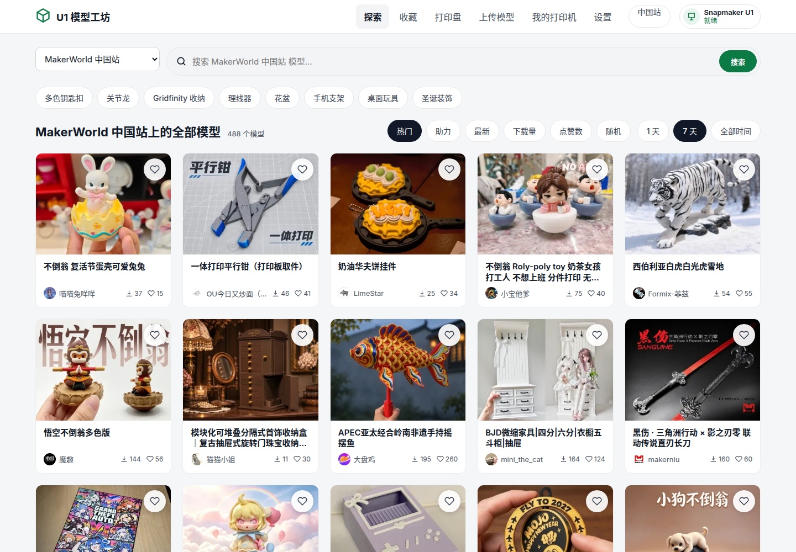
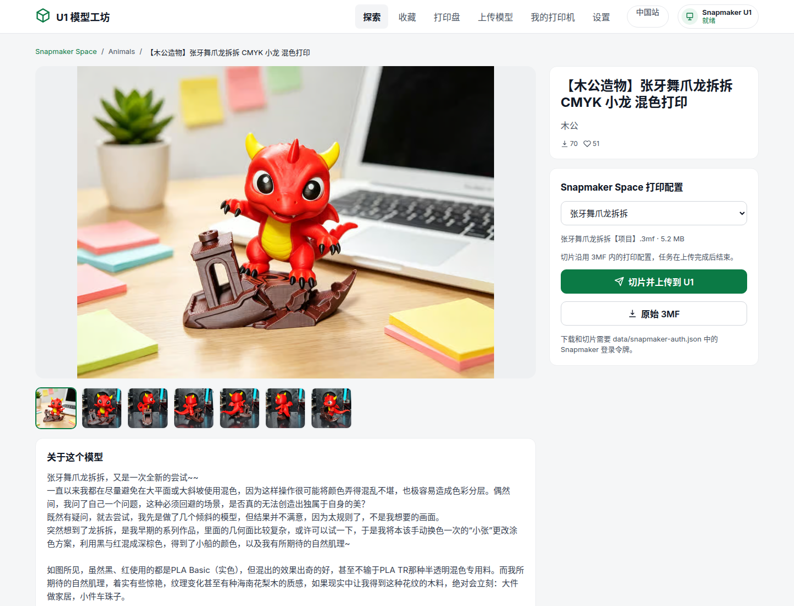
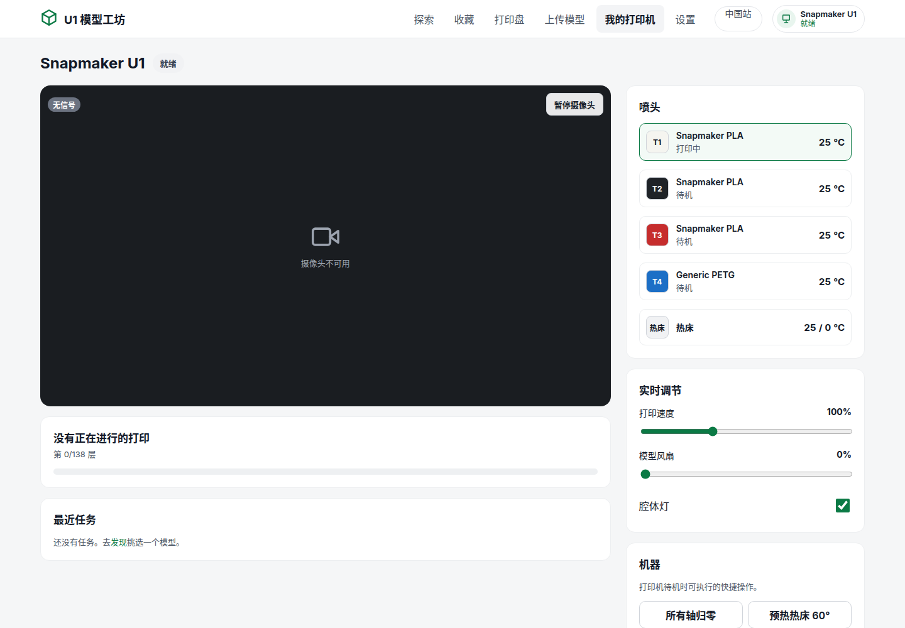
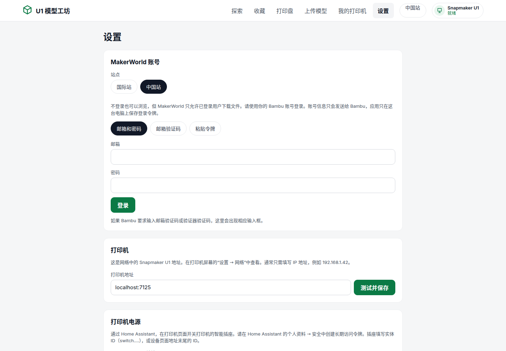
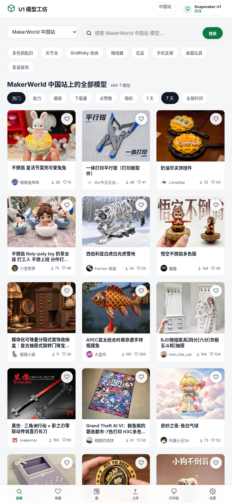
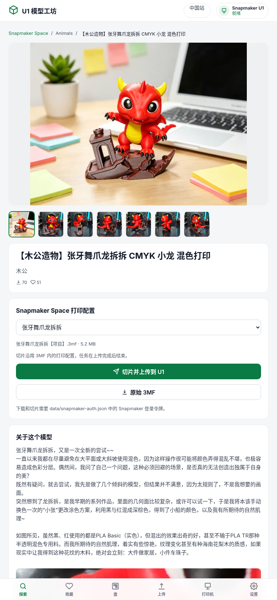
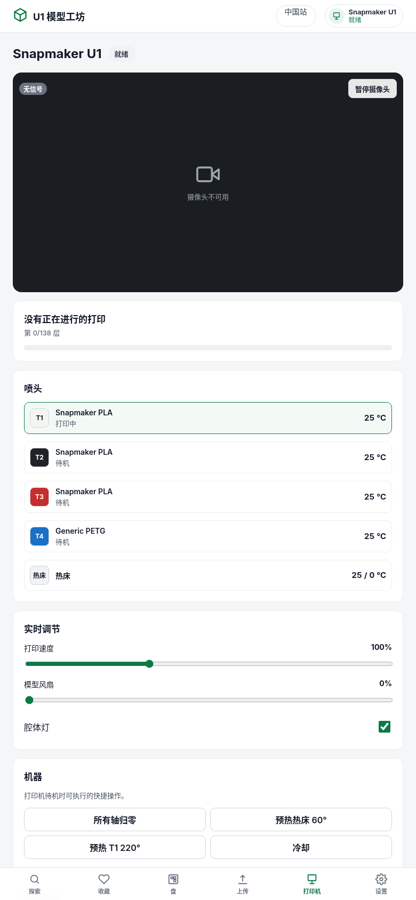

# 🖨️ U1 Maker Hub

[简体中文](README.md) ｜ **English**

> [!WARNING]
> 🚧 **This project is vibe-coded.** It was built quickly, with heavy help from an AI coding assistant, for my own personal use with my own printer. Expect bugs, rough edges and missing checks. It works for me, but it has not been hardened or tested on other setups. I'm releasing it in case it helps other Snapmaker U1 owners, and I will keep improving it. Issues and pull requests are welcome.

**🌍 From model sites to your Snapmaker U1 in a few taps. ✨**

U1 Maker Hub is a self-hosted web app that lets you browse model sites, re-slice any model for the **Snapmaker U1** with tuned presets, and send it straight to the printer, from your phone or your desktop. 📱💻

<p align="center">
  
</p>

## 🤔 Why

Model sites have huge libraries, but most models come with Bambu Lab print profiles. Printing them on a Snapmaker U1 means downloading the 3MF, opening a slicer, swapping the printer, process and filament settings, mapping colours to toolheads, exporting the G-code and uploading it. U1 Maker Hub does all of that in one screen: pick a model, pick a preset, press **Print**.

## ✨ Features

### 🔎 Find models

- 🌐 **Three sources:** MakerWorld China, MakerWorld International and Snapmaker Space International. Switch between them with a dropdown while browsing.
- 🔀 **Cross-source search:** type a keyword and all three are searched at once, with results interleaved per source. The chips above the grid let you include or exclude sources.
- ❤️ **Saved models:** keep favourites to print later.
- 📤 **Uploads:** bring your own STL or 3MF files.

### 🛠️ Prepare the print

- 🎛️ **Tuned U1 presets:** Fast & clean, Standard and Fine detail. The Bambu settings in the 3MF are replaced with a complete U1 configuration; geometry, plates and colour painting are kept.
- 🧑‍🎓 **Beginner-friendly options:** supports, brim, size and orientation, without slicer jargon.
- 📐 **Adaptive layer heights:** computed from the slope of the mesh, like OrcaSlicer's "Adaptive" button, because OrcaSlicer's command line ignores that setting.
- 🎨 **Multi-colour:** choose which of the U1's four toolheads prints each colour. More than four colours can share toolheads.
- 🧩 **Multi-model plates:** combine several models and copies on one plate, with automatic packing onto as many plates as needed.
- 👀 **Preview:** 3D bed view before slicing and toolpath view after slicing, with print time, filament use and cost.

### 🚀 Print and monitor

- ⚡ **One-click send:** slices with OrcaSlicer, uploads to the U1 through Moonraker, maps colours to toolheads and starts the print.
- 📷 **My printer:** live state, camera, temperatures, the four toolheads, pause, resume, cancel, speed, fan and light.
- 🔌 **Printer power (optional):** turn the printer's smart plug on and off through Home Assistant. Turning off is blocked while a print is running.
- 📲 **Installable PWA:** mobile-first layout, add it to your phone's home screen.

## 📸 Screenshots

| Model page: profile, U1 preset and options | Printer: toolheads, camera and live controls |
|---|---|
|  |  |

| Settings | On your phone |
|---|---|
|  |    |

## 📋 Requirements

- 🧠 **OrcaSlicer 2.4 or newer.** On macOS: `brew install --cask orcaslicer`. On Linux, see `deploy/setup-lxc.sh`. Snapmaker Orca's command line crashes on recent Bambu files, so it is not used.
- 🟢 **Node 20 or newer**, and pnpm.
- 👤 **A Bambu Lab account** to download MakerWorld files. Search works without one.
- 🖨️ **A Snapmaker U1** on the same network. Its Moonraker API must accept this computer; see Troubleshooting.
- 🔑 **A Snapmaker Space token** to download from that source, kept in `data/snapmaker-auth.json` (see below).

## ⚡ Quick start

```bash
pnpm install
pnpm dev            # http://localhost:3000
```

Then open **Settings**:

1. Log in with your Bambu account. Email and password work, plus an emailed or authenticator code. You can also paste the `token` cookie from makerworld.com.
2. Enter the printer address, for example `192.168.1.42`, and press **Test & save**.
3. Set what is loaded in T1 to T4, or press **Read from printer**.
4. Optional: set your Home Assistant address, the plug's entity id and a long-lived access token to get a power button.
5. Optional: for Snapmaker Space models, put the `access` and `refresh` tokens into `data/snapmaker-auth.json` (format below). The app refreshes the access token by itself, so you only touch this once.

🧪 To work without the printer, run a fake U1 and use `localhost:7125` as the printer address:

```bash
pnpm mock-printer
```

### 🔑 Snapmaker Space credentials

Sign in to `space.snapmaker.com`, open DevTools → Application → Cookies, and copy `login_access_token` and `login_refresh_token`:

```json
{
  "access": "eyJraWQiOi...",
  "refresh": "Os3jbN2q..."
}
```

Save it as `data/snapmaker-auth.json` with mode `600`. That directory is git-ignored.

> [!NOTE]
> The access token lasts 24 hours and the refresh token about 30 days. The app swaps the access token using the refresh token before it expires and writes the rotated pair back to the same file. You only need to fill this in again when the refresh token itself dies, for example after signing in somewhere else, or if 30 days pass without use.

## 🐳 Docker

The image bundles OrcaSlicer, so Docker is all you need:

```bash
docker compose up -d --build      # http://<host>:3000
docker compose logs -f
```

Settings, the Bambu token, favourites, downloads and jobs are kept in the `u1-data` volume. To pick another OrcaSlicer release, change `ORCA_VERSION` in `docker-compose.yml` and rebuild.

⚠️ The image is `linux/amd64` only, because OrcaSlicer publishes no ARM Linux build. It runs on ARM hosts (Apple Silicon, Raspberry Pi) through emulation, but slicing becomes several times slower; an x86_64 machine is strongly recommended.

### 📊 Resources

Slicing is the only heavy part; the web app itself idles at about 140 MB. OrcaSlicer runs once per plate, one plate after the other, so peaks don't add up.

| | Minimum | Recommended |
|---|---|---|
| 🧮 CPU | 1 core | 2 to 4 cores. OrcaSlicer is multi-threaded: more cores mean faster slicing, not more capacity |
| 🧠 RAM | 2 GB | **3 GB + 512 MB swap** (the compose default). A 5-colour model peaks at about 600 MB; a large vase-mode model peaks at 1.6 GB on Fast and 2.7 GB on Fine detail |
| 💾 Disk | 3 GB | 10 GB. The image is about 600 MB to download and 1.7 GB on disk; downloads and jobs grow over time in the `u1-data` volume, clean it up now and then |

💥 If the slicer hits the memory limit, the kernel kills it and the print fails with a slicing error: raise `memory` in `docker-compose.yml` or pick a faster preset. With less than 2 GB, keep to small models on Fast.

## 🏠 Self-hosting without Docker

The app is meant to run on a small always-on machine on your home network. `deploy/` has scripts for an Ubuntu 24.04 server or LXC container:

1. Provision it once (Node 22, OrcaSlicer and its libraries, a service user and a systemd unit):

   ```bash
   ssh root@<server-ip> 'bash -s' < deploy/setup-lxc.sh
   ```

2. Deploy or update the app (rsync, install, build, restart, health check):

   ```bash
   DEPLOY_HOST=root@<server-ip> deploy/deploy.sh
   ```

3. Open `http://<server-ip>:3000` and configure it in **Settings**.

Data lives in `/var/lib/u1-maker-hub` on the server. Give it about 3 GB of RAM: slicer memory depends on the model, and a large model on Fine detail can peak around 2.7 GB.

> [!CAUTION]
> 🔒 The app has **no login of its own** and stores your Bambu token. Do not expose it directly to the internet. Keep it on your LAN, or put it behind a VPN or an authenticating reverse proxy.

## ⚙️ How it works

| Step | What happens |
|---|---|
| 🔎 Search and model pages | MakerWorld `api.bambulab.com` (International) and `api.bambulab.cn` (China) search and design endpoints, plus the public `api-models.snapmaker.com` endpoints, none of which need auth |
| ⬇️ Download | MakerWorld uses `design-service/instance/{id}/f3mf` with your Bambu token, then the signed CDN link. Snapmaker Space exchanges its token for a time-limited signed URL first |
| 🔁 Preset swap | OrcaSlicer exports a full U1 config (machine, process, filaments) that replaces `Metadata/project_settings.config` in the 3MF |
| 📐 Adaptive layers | Optional. The app computes the height profile from the mesh and writes it to `Metadata/layer_heights_profile.txt` in the 3MF |
| 🔪 Slice | `OrcaSlicer --load-settings … --load-filaments … --slice N` |
| 📡 Send | Moonraker upload, then `SET_PRINT_EXTRUDER_MAP` per colour, then start |

Model colour N is printed as logical tool T(N-1), and the U1 firmware maps it to the toolhead you chose.

**Snapmaker Space models skip the preset swap.** They ship a complete U1 configuration already, so the 3MF is sliced as-is. A few of them carry custom start G-code that only Snapmaker's Orca build understands (`{if chamber_cooling_mode==...}`), which stock OrcaSlicer cannot parse; for those, only that one key is replaced with the official preset's version and everything else is kept.

Local data lives in `./data`, which git ignores: the token in `settings.json` with mode 600, `snapmaker-auth.json`, downloads, and jobs. The Bambu token is only sent to `api.bambulab.com` / `api.bambulab.cn`, and the Snapmaker token only to `api.snapmaker.com`.

## 🩺 Troubleshooting

- 🔑 **"Downloading needs your Bambu account"**: log in on the Settings page. Logins last about 90 days.
- 🤖 **Captcha or rate limit**: Bambu sometimes challenges new devices. Open makerworld.com in your browser, then retry later.
- 🚫 **Printer 401**: your network is not in Moonraker's `trusted_clients`. The stock config trusts 10.x, 172.16 to 31.x and 192.x.
- 📷 **Camera**: stock firmware has no video stream. The camera rewrites a 1080p photo about 3.5 times a second after a wake call, which the app sends while you watch. Smooth video needs the community Extended Firmware.
- 🔑 **Snapmaker token expired**: the refresh token in `data/snapmaker-auth.json` is dead. Sign in to `space.snapmaker.com` again and paste a fresh pair. Sign out first and sign back in; reloading the page does not refresh the cookies.

## ⚠️ Caveats

- MakerWorld has no public API. The endpoints used here are reverse-engineered and can break at any time.
- MakerWorld's terms (section 9) forbid automated access. Keep this a personal, single-user tool, and respect each model's license.
- The same goes for Snapmaker Space: check the license on each model page. Personal use is fine, reselling is not.
- This project is not affiliated with Bambu Lab, MakerWorld, Snapmaker or OrcaSlicer.

## 🎨 Design

The original screen designs (Claude Design canvas source) are in `docs/design/`.

## 📄 License

[MIT](LICENSE)
