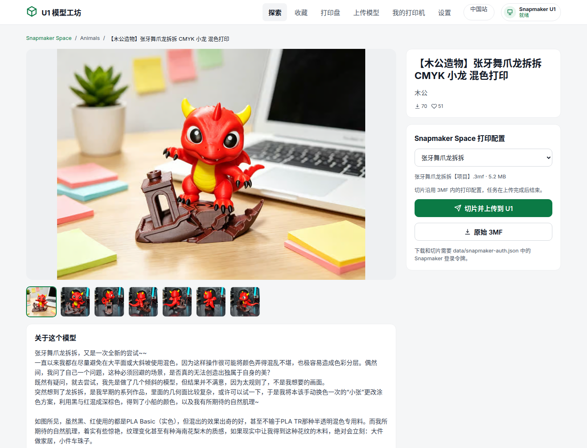

# 🖨️ U1 Maker Hub

**简体中文** ｜ [English](README.en.md)

> [!WARNING]
> 🚧 **这个项目是边聊边写出来的（vibe-coded）。** 我用 AI 辅助快速攒起来，给自己和自家打印机用。bug、粗糙的地方、缺失的校验都会有。在我这儿能跑，但没在别的环境上加固和测试过。放出来是希望帮到其他 Snapmaker U1 机主，我也会继续改。欢迎提 issue 和 PR。

**🌍 点几下，把模型网站上的东西送到你的 Snapmaker U1。✨**

U1 Maker Hub 是一个自托管的网页应用：浏览模型、按 U1 的预设重新切片、直接发送到打印机，手机和电脑都能用。📱💻

<p align="center">
  
</p>

## 🤔 为什么要做这个

MakerWorld 上有海量模型，但绝大多数附带的是拓竹的打印配置。想拿到 Snapmaker U1 上打印，得下载 3MF、打开切片软件、换打印机、换流程、换耗材、把颜色映射到喷头、导出 G-code、再上传。U1 Maker Hub 把这些压到一个页面里：选模型、选预设、点**打印**。

## ✨ 功能

### 🔎 找模型

- 🌐 **三个内容来源**：MakerWorld 中国站、MakerWorld 国际站、Snapmaker Space 国际站。浏览时用下拉框切站。
- 🔀 **跨站搜索**：输入关键词后，三个站同时搜，结果按站点交替穿插。上面的标签可以多选，把不想看的站剔掉。
- ❤️ **收藏**：留着以后打印。
- 📤 **上传**：自己手里的 STL 或 3MF 也能用。

### 🛠️ 准备打印

- 🎛️ **调过的 U1 预设**：快速、标准、精细三档。3MF 里的拓竹配置会被换成完整的 U1 配置，模型几何、盘面和上色都保留。
- 🧑‍🎓 **不用懂切片参数**：支撑、边缘、缩放、摆放，都用大白话。
- 📐 **自适应层高**：根据模型表面的坡度自动算，效果等同于 OrcaSlicer 里的「自适应」按钮——因为 OrcaSlicer 的命令行不认那个设置。
- 🎨 **多色**：U1 四个喷头，每种颜色用哪个喷头由你定。超过四种颜色可以共用喷头。
- 🧩 **一盘多个模型**：几个模型和副本摆在同一盘，放不下就自动排到下一盘。
- 👀 **预览**：切片前看 3D 盘面，切片后看走刀路径，附带打印时长、耗材用量和成本。

### 🚀 打印和监控

- ⚡ **一键发送**：调 OrcaSlicer 切片，通过 Moonraker 上传到 U1，映射颜色到喷头，然后启动。
- 📷 **我的打印机**：实时状态、摄像头、温度、四个喷头、暂停、继续、取消、速度、风扇和照明。
- 🔌 **打印机电源（可选）**：通过 Home Assistant 控制打印机的智能插座。打印中禁止断电。
- 📲 **可安装的 PWA**：为手机排的版式，能加到主屏幕。

## 📸 截图

| 模型页：配置、U1 预设和选项 | 打印机页：喷头、摄像头和实时控制 |
|---|---|
|  |  |

| 设置 | 手机上 |
|---|---|
|  |    |

## 📋 运行要求

- 🧠 **OrcaSlicer 2.4 或更新版本。** macOS 上 `brew install --cask orcaslicer`；Linux 见 `deploy/setup-lxc.sh`。Snapmaker 定制版 Orca 的命令行处理新版拓竹文件会段错误，所以不用它。
- 🟢 **Node 20 或更新版本**，以及 pnpm。
- 👤 **下载文件需要拓竹账号**。只搜索不需要。
- 🖨️ **同一局域网里的 Snapmaker U1**。它的 Moonraker 接口得允许这台机器访问，见「常见问题」。
- 🔑 **要下载 Snapmaker Space 的模型**，需要一份登录 token，放进 `data/snapmaker-auth.json`（见下方说明）。

## ⚡ 快速开始

```bash
pnpm install
pnpm dev            # http://localhost:3000
```

然后打开**设置**页：

1. 用拓竹账号登录。邮箱加密码可以，邮箱验证码和验证器也支持。也可以直接粘贴 makerworld.com 的 `token` cookie。
2. 填打印机地址（例如 `192.168.1.42`），点**测试并保存**。
3. 设置 T1 到 T4 各装的什么耗材，或者点**从打印机读取**。
4. 可选：填 Home Assistant 地址、插座的实体 ID 和长期访问令牌，就有电源按钮了。
5. 可选：要用 Snapmaker Space 的模型，把 `access` 和 `refresh` 两个 token 写进 `data/snapmaker-auth.json`，格式见下文。access 过期后应用会自动用 refresh 续期，不用手动换。

🧪 手边没有打印机也能开发，跑一个假 U1，把打印机地址填 `localhost:7125`：

```bash
pnpm mock-printer
```

### 🔑 Snapmaker Space 的凭据

在浏览器登录 `space.snapmaker.com`，F12 打开开发者工具 → Application → Cookies，复制 `login_access_token` 和 `login_refresh_token`，写成：

```json
{
  "access": "eyJraWQiOi...",
  "refresh": "Os3jbN2q..."
}
```

存到 `data/snapmaker-auth.json`，权限设成 `600`。这个目录已被 git 忽略。

> [!NOTE]
> access token 有效期 24 小时，refresh 有效期约 30 天。应用会在 access 快过期时自动用 refresh 换新的，并把换回来的新凭据写回这个文件。只有当 refresh 本身失效（比如你重新登录过、或者超过 30 天没动）才需要重新填一次。

## 🐳 Docker

镜像里已经打好 OrcaSlicer，只要有 Docker 就行：

```bash
docker compose up -d --build      # http://<宿主机>:3000
docker compose logs -f
```

设置、拓竹 token、收藏、下载和任务都存在 `u1-data` 卷里。想换 OrcaSlicer 版本，改 `docker-compose.yml` 里的 `ORCA_VERSION` 再重新构建。

⚠️ 镜像只有 `linux/amd64`，因为 OrcaSlicer 没有发布 ARM 版 Linux 构建。在 ARM 机器（Apple Silicon、树莓派）上能靠模拟跑起来，但切片会慢好几倍，**强烈建议用 x86_64 机器**。

### 📊 资源占用

切片是唯一吃资源的部分，网页本身空闲时大约 140 MB。OrcaSlicer 是逐盘运行的，一盘切完再切下一盘，峰值不会叠加。

| | 最低 | 推荐 |
|---|---|---|
| 🧮 CPU | 1 核 | 2 到 4 核。OrcaSlicer 是多线程的：核多只影响切片快慢，不影响能切多大的模型 |
| 🧠 内存 | 2 GB | **3 GB + 512 MB swap**（compose 里的默认值）。五色模型的峰值约 600 MB；大盘的螺旋花瓶模式模型，快速档峰值约 1.6 GB，精细档约 2.7 GB |
| 💾 硬盘 | 3 GB | 10 GB。镜像下载约 600 MB、占盘约 1.7 GB；下载和任务会随着使用在 `u1-data` 卷里堆积，记得偶尔清一清 |

💥 切片器撞到内存上限时会被内核杀掉，打印会以切片失败告终：调高 `docker-compose.yml` 里的 `memory`，或者换更快的预设。内存不到 2 GB 的话，就只切小模型、只用快速档。

## 🏠 不用 Docker 自己部署

这个应用适合跑在家里的常开小机器上。`deploy/` 里有给 Ubuntu 24.04 服务器或 LXC 容器准备的脚本：

1. 初始化（装 Node 22、OrcaSlicer 及其依赖库、服务账号和 systemd 单元）：

   ```bash
   ssh root@<服务器IP> 'bash -s' < deploy/setup-lxc.sh
   ```

2. 部署或更新应用（rsync、安装、构建、重启、健康检查）：

   ```bash
   DEPLOY_HOST=root@<服务器IP> deploy/deploy.sh
   ```

3. 打开 `http://<服务器IP>:3000`，在**设置**页完成配置。

数据存放在服务器的 `/var/lib/u1-maker-hub`。给它 3 GB 左右内存：切片的内存占用跟模型有关，大盘模型用精细档峰值能到 2.7 GB。

> [!CAUTION]
> 🔒 这个应用**自己没有登录功能**，还会保存你的拓竹 token。别直接暴露到公网。放在局域网里，或者套一层 VPN 或带认证的反向代理。

## ⚙️ 工作原理

| 步骤 | 发生了什么 |
|---|---|
| 🔎 搜索和模型页 | MakerWorld 的 `api.bambulab.com`（国际站）/ `api.bambulab.cn`（中国站）搜索与详情接口，Snapmaker Space 的 `api-models.snapmaker.com` 公开接口，都不需要登录 |
| ⬇️ 下载 | MakerWorld 走 `design-service/instance/{id}/f3mf`（带拓竹 token）再跟随签名 CDN 链接；Snapmaker Space 先用自己的 token 调签名接口换取带时效的下载地址 |
| 🔁 替换预设 | OrcaSlicer 导出一份完整的 U1 配置（机器、流程、耗材），覆盖 3MF 里的 `Metadata/project_settings.config` |
| 📐 自适应层高 | 可选。应用从网格算出层高曲线，写进 3MF 的 `Metadata/layer_heights_profile.txt` |
| 🔪 切片 | `OrcaSlicer --load-settings … --load-filaments … --slice N` |
| 📡 发送 | Moonraker 上传，然后按颜色下发 `SET_PRINT_EXTRUDER_MAP`，最后启动 |

模型的第 N 种颜色会用逻辑喷头 T(N-1) 打印，U1 固件再把它映射到你选的那个喷头。

**Snapmaker Space 的模型不需要替换预设**——它们自带完整的 U1 配置，直接切就行。个别模型的开头 G-code 用了 Snapmaker 定制版 Orca 的私有语法（`{if chamber_cooling_mode==...}`），标准 OrcaSlicer 解析不了，应用会只把这一项换成官方预设里的写法，其余配置原样保留。

本地数据在 `./data` 目录，已被 git 忽略：`settings.json` 里的 token（权限 600）、`snapmaker-auth.json`、下载缓存和任务记录。拓竹 token 只会发给 `api.bambulab.com` / `api.bambulab.cn`，Snapmaker 的 token 只会发给 `api.snapmaker.com`。

## 🩺 常见问题

- 🔑 **提示「下载需要拓竹账号」**：去设置页登录。登录状态大约能保持 90 天。
- 🤖 **遇到验证码或限流**：拓竹有时会挑战新设备。用浏览器打开 makerworld.com 过一次，过一阵再试。
- 🚫 **打印机返回 401**：你的网段不在 Moonraker 的 `trusted_clients` 里。出厂配置信任 10.x、172.16 到 31.x 和 192.x。
- 📷 **摄像头**：出厂固件没有视频流。摄像头在收到唤醒请求后会以每秒约 3.5 次的频率刷新一张 1080p 照片，应用在你盯着画面时会持续发唤醒请求。要流畅视频得刷社区版扩展固件。
- 🔑 **提示 Snapmaker token 已过期**：`data/snapmaker-auth.json` 里的 refresh 失效了，重新登录 `space.snapmaker.com` 复制一份新的填进去。注意要**先退出登录再重新登录**，光刷新页面浏览器不会更新 cookie。

## ⚠️ 注意事项

- MakerWorld 没有公开 API。这里用的接口是逆向出来的，随时可能失效。
- MakerWorld 的服务条款（第 9 条）禁止自动化访问。请把它当作个人、单用户的工具使用，并尊重每个模型的许可协议。
- Snapmaker Space 同理，模型许可以模型页声明的为准，自用没问题，不要转售。
- 本项目与拓竹（Bambu Lab）、MakerWorld、Snapmaker、OrcaSlicer 均无关联。

## 🎨 设计稿

最初的界面设计源文件（Claude Design canvas）在 `docs/design/`。

## 📄 许可证

[MIT](LICENSE)
