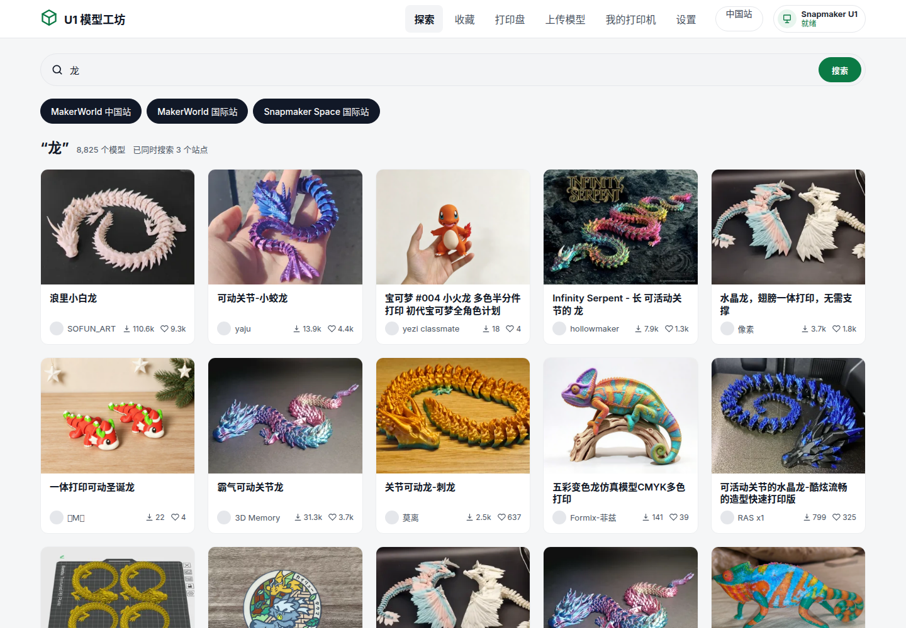
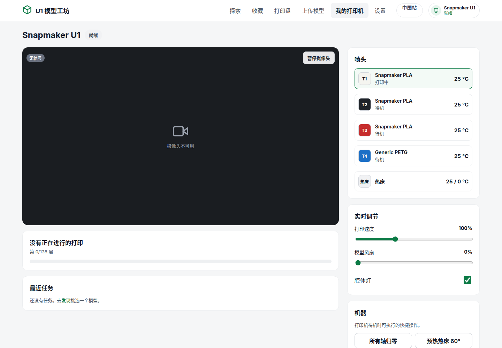
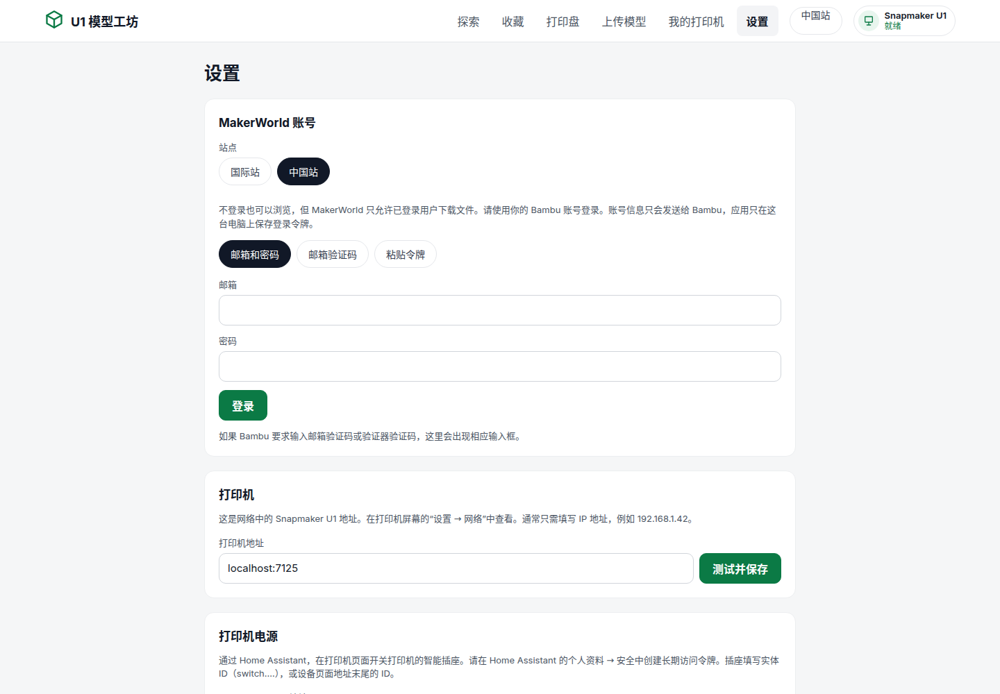
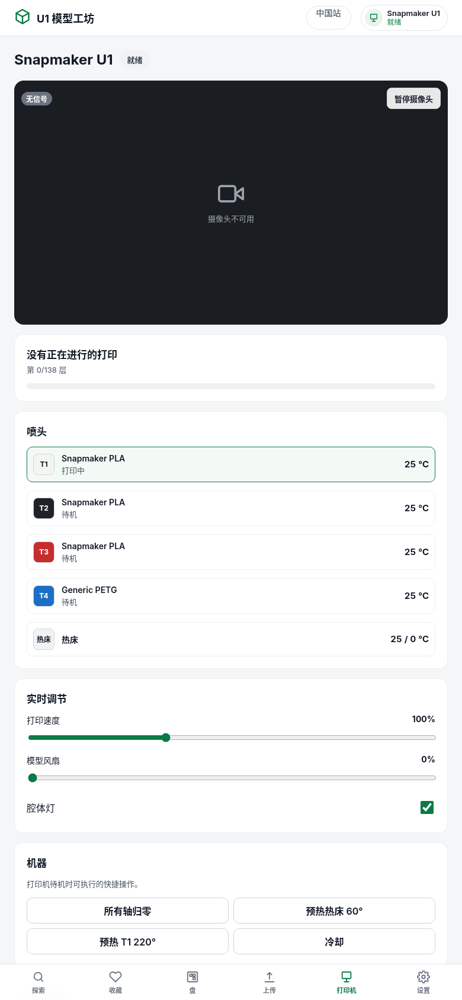

# 🖨️ U1 模型工坊（U1 Maker Hub）

**简体中文** ｜ [English](README.en.md)

> [!WARNING]
> 🚧 **这个项目是边聊边写出来的（vibe-coded）。** 我用 AI 辅助快速攒起来，给自己和自家打印机用。bug、粗糙的地方、缺失的校验都会有。在我这儿能跑，但没在别的环境上加固和测试过。放出来是希望帮到其他 Snapmaker U1 机主，我也会继续改。欢迎提 issue 和 PR。

**🌍 三个模型站，一个界面，点几下送到你的 Snapmaker U1。**

U1 模型工坊是一个自托管的网页应用：同时浏览 MakerWorld 中国站、MakerWorld 国际站和 Snapmaker Space 国际站，按 U1 的预设重新切片，直接推送到打印机。手机和电脑都能用。

<p align="center">
  
</p>

## 🔀 多站点：这个项目最不一样的地方

原版只接 MakerWorld 一个源，这份改成了三个：

| 站点 | 内部代号 | 浏览/搜索 | 下载 | 模型自带 U1 配置 |
|---|---|---|---|---|
| MakerWorld 中国站 | `mw-cn` | 免登录 | 需拓竹账号 | 否，需换 U1 预设 |
| MakerWorld 国际站 | `mw-intl` | 免登录 | 需拓竹账号 | 否，需换 U1 预设 |
| Snapmaker Space 国际站 | `sm-intl` | 免登录 | 需 Snapmaker 令牌 | **是，可直接切** |

### 浏览：手动切站

首页顶部有个下拉框，切到哪个站就看哪个站的内容。排序、时间范围、随机抽取都只作用于当前站——不搞跨站混排，因为三个站的排序口径根本对不上。

### 搜索：一次搜三个站

输入关键词后，行为就变了：

- **三站同时搜**，结果按站点交替穿插：中国站一个、国际站一个、Snapmaker 一个，再循环
- **站点标签多选**，默认三个全选，点掉哪个就不搜哪个（至少留一个）
- **排序控件消失**——因为跨站没有统一的相关性分数。MakerWorld 返回的是它自己的相关性排序，Snapmaker 只按发布时间返回，硬拼一个"全局排序"就是在骗人。所以搜索态只按各站自己的顺序交替展示
- **单站挂了不影响其他**，页面上方会提示哪个站暂时不可用

每次搜索三站并行，实测 8397 条结果耗时约 1.19 秒。

> [!NOTE]
> 搜索结果的卡片上目前**没有站点标识**。看上图能看到中英文混排（`浪里小白龙`、`Infinity Serpent`），但单看卡片分不出它来自哪个站。这是已知的小缺陷，跨站 ID 冲突已经用前缀解决了（`mw-cn:436580` / `sm-intl:53712` 不会互相吞），只是 UI 上还没画出来。

## 🤔 为什么要做这个

模型站上模型很多，但 MakerWorld 的模型大多附带拓竹的打印配置。想拿到 Snapmaker U1 上打印，得下载 3MF、打开切片软件、换打印机、换流程、换耗材、把颜色映射到喷头、导出 G-code、再上传。U1 模型工坊把这些压到一个页面里：选模型、选预设、点按钮。

Snapmaker Space 的模型省事得多——它们自带完整的 U1 四喷头配置，多数直接就能切。

## ✨ 功能

### 🔎 找模型

- 🌐 **三个站点**，浏览器里切换，搜索时聚合，见上一节
- ❤️ **收藏**：留着以后打印
- 📤 **上传**：自己手里的 STL 或 3MF 也能用

### 🛠️ 准备打印

- 🎛️ **调过的 U1 预设**：快速、标准、精细三档。MakerWorld 的模型会把 3MF 里的拓竹配置整个换成 U1 配置，模型几何、盘面和上色都保留
- 🧑‍🎓 **不用懂切片参数**：支撑、边缘、缩放、摆放，都用大白话
- 📐 **自适应层高**：根据模型表面坡度自动算，效果等同于 OrcaSlicer 里的「自适应」按钮——因为 OrcaSlicer 的命令行不认那个设置
- 🎨 **多色**：U1 四个喷头，每种颜色用哪个喷头由你定，超过四色可以共用
- 🧩 **一盘多个模型**：几个模型和副本摆在同一盘，放不下自动排到下一盘
- 👀 **预览**：切片前看 3D 盘面，切片后看走刀路径，附带时长、耗材和成本

### 🚀 打印和监控

- ⚡ **一键发送**：调 OrcaSlicer 切片，通过 Moonraker 上传到 U1，映射颜色到喷头，然后启动
- 📷 **我的打印机**：实时状态、摄像头、温度、四个喷头、暂停、继续、取消、速度、风扇和照明
- 🔌 **打印机电源（可选）**：通过 Home Assistant 控制智能插座，打印中禁止断电
- 📲 **可安装的 PWA**：为手机排的版式，能加到主屏幕

## 📸 截图

| 浏览：顶部下拉切站 | 模型页：Snapmaker 模型自带配置 |
|---|---|
|  |  |

| 打印机：喷头、摄像头和实时控制 | 设置 |
|---|---|
|  |  |

手机上：

<p align="center">
  
  
  
</p>

> 截图里的打印机是项目自带的 mock（`pnpm mock-printer`），所以显示"摄像头不可用"。真实打印机上装社区扩展固件后会有画面。

## 📋 运行要求

- 🧠 **OrcaSlicer 2.4 或更新版本。** macOS 上 `brew install --cask orcaslicer`；Linux 见 `deploy/setup-lxc.sh`。Snapmaker 定制版 Orca 的命令行处理新版拓竹文件会段错误，所以不用它
- 🟢 **Node 20 或更新版本**，以及 pnpm
- 👤 **下载 MakerWorld 的文件需要拓竹账号**。只搜索不需要
- 🖨️ **同一局域网里的 Snapmaker U1**。它的 Moonraker 接口得允许这台机器访问，见「常见问题」
- 🔑 **要下载 Snapmaker Space 的模型**，需要一份登录令牌，放进 `data/snapmaker-auth.json`

## ⚡ 快速开始

```bash
pnpm install
pnpm dev            # http://localhost:3000
```

然后打开**设置**页：

1. 用拓竹账号登录。邮箱加密码可以，邮箱验证码和验证器也支持，还能直接粘贴 makerworld.com 的 `token` cookie
2. 填打印机地址（例如 `192.168.1.42`），点**测试并保存**
3. 设置 T1 到 T4 各装的什么耗材，或者点**从打印机读取**
4. 可选：填 Home Assistant 地址、插座实体 ID 和长期访问令牌，就有了电源按钮
5. 可选：要用 Snapmaker Space 的模型，把令牌写进 `data/snapmaker-auth.json`（见下）

🧪 手边没有打印机也能开发，跑一个假 U1，把打印机地址填 `localhost:7125`：

```bash
pnpm mock-printer
```

### 🔑 Snapmaker Space 的令牌

在浏览器登录 `space.snapmaker.com`，F12 打开开发者工具 → Application → Cookies，复制 `login_access_token` 和 `login_refresh_token`：

```json
{
  "access": "eyJraWQiOi...",
  "refresh": "Os3jbN2q..."
}
```

存成 `data/snapmaker-auth.json`，权限 `600`。这个目录已被 git 忽略。

> [!NOTE]
> access 令牌 24 小时过期，refresh 约 30 天。应用会在 access 快过期时自动用 refresh 换新的，并把换回来的新凭据写回同一个文件——所以正常情况下你只需要填这一次。只有 refresh 本身失效了（比如在别处重新登录过，或者超过 30 天没用）才需要再填。

## 🐳 Docker

镜像里已经打好 OrcaSlicer，只要有 Docker 就行：

```bash
docker compose up -d --build      # http://<宿主机>:3000
docker compose logs -f
```

设置、令牌、收藏、下载和任务都存在 `u1-data` 卷里。想换 OrcaSlicer 版本，改 `docker-compose.yml` 里的 `ORCA_VERSION` 再重新构建。

⚠️ 镜像只有 `linux/amd64`，因为 OrcaSlicer 没有发布 ARM 版 Linux 构建。在 ARM 机器上能靠模拟跑，但切片会慢好几倍，**强烈建议用 x86_64 机器**。

### 📊 资源占用

切片是唯一吃资源的部分，网页本身空闲时大约 140 MB。OrcaSlicer 逐盘运行，一盘切完再切下一盘，峰值不叠加。

| | 最低 | 推荐 |
|---|---|---|
| 🧮 CPU | 1 核 | 2 到 4 核。OrcaSlicer 是多线程的：核多只影响切片快慢 |
| 🧠 内存 | 2 GB | **3 GB + 512 MB swap**（compose 默认值）。五色模型峰值约 600 MB；大盘螺旋花瓶模式，快速档约 1.6 GB，精细档约 2.7 GB |
| 💾 硬盘 | 3 GB | 10 GB。镜像约 600 MB 下载、占盘 1.7 GB；下载和任务会在 `u1-data` 卷里堆积，记得偶尔清一清 |

💥 切片器撞到内存上限会被内核杀掉，打印会以切片失败告终：调高 `docker-compose.yml` 里的 `memory`，或者换更快的预设。内存不到 2 GB 就只切小模型、只用快速档。

## 🏠 不用 Docker 自己部署

适合跑在家里的常开小机器上。`deploy/` 里有给 Ubuntu 24.04 服务器或 LXC 容器准备的脚本：

1. 初始化（装 Node 22、OrcaSlicer 及其依赖库、服务账号和 systemd 单元）：

   ```bash
   ssh root@<服务器IP> 'bash -s' < deploy/setup-lxc.sh
   ```

2. 部署或更新（rsync、安装、构建、重启、健康检查）：

   ```bash
   DEPLOY_HOST=root@<服务器IP> deploy/deploy.sh
   ```

3. 打开 `http://<服务器IP>:3000`，在**设置**页完成配置

数据在服务器的 `/var/lib/u1-maker-hub`。给它 3 GB 左右内存：切片占用跟模型有关，大盘模型用精细档峰值能到 2.7 GB。

> [!CAUTION]
> 🔒 这个应用**自己没有登录功能**（可选的应用层密码除外），还会保存你的拓竹令牌。别直接暴露到公网。放在局域网里，或者套一层 VPN 或带认证的反向代理。

## ⚙️ 工作原理

| 步骤 | 发生了什么 |
|---|---|
| 🔎 搜索 | MakerWorld 走 `api.bambulab.cn` / `api.bambulab.com`，Snapmaker 走 `api-models.snapmaker.com`，都不需要登录 |
| ⬇️ 下载 | MakerWorld 用 `design-service/instance/{id}/f3mf`（带拓竹令牌）再跟随签名 CDN 链接；Snapmaker 先用自己的令牌换一个带时效的签名地址 |
| 🔁 替换预设 | 仅 MakerWorld。OrcaSlicer 导出一份完整 U1 配置（机器、流程、耗材），覆盖 3MF 里的 `Metadata/project_settings.config` |
| 🩹 修私有语法 | 少数 Snapmaker 模型带着 `{if …}{endif}` 条件块（Snapmaker 定制版 Orca 的扩展），标准 OrcaSlicer 读到不认识的变量名会直接 `return -100`。应用会把出问题的 G-code 键换成官方 U1 预设的写法，其余配置一个不动，重新打包后再切 |
| 📐 自适应层高 | 可选。从网格算出层高曲线，写进 3MF 的 `Metadata/layer_heights_profile.txt` |
| 🔪 切片 | `OrcaSlicer --load-settings … --load-filaments … --slice N` |
| 📡 发送 | Moonraker 上传，然后按颜色下发 `SET_PRINT_EXTRUDER_MAP`，最后启动 |

模型的第 N 种颜色用逻辑喷头 T(N-1) 打印，U1 固件再映射到你选的那个喷头。

本地数据在 `./data`，已被 git 忽略：`settings.json` 里的令牌（权限 600）、`snapmaker-auth.json`、下载缓存和任务记录。拓竹令牌只发给 `api.bambulab.com` / `api.bambulab.cn`，Snapmaker 令牌只发给 `api.snapmaker.com`。

## 🩺 常见问题

- 🔑 **提示「下载需要拓竹账号」**：去设置页登录。登录状态一般能保持挺久
- 🤖 **遇到验证码或限流**：拓竹有时会挑战新设备。用浏览器打开 makerworld.com 过一次，过一阵再试
- 🚫 **打印机返回 401**：你的网段不在 Moonraker 的 `trusted_clients` 里。出厂配置信任 10.x、172.16 到 31.x 和 192.x
- 📷 **摄像头黑屏**：出厂固件没有视频流，只以每秒几次的频率刷新静态照片。要流畅视频得刷社区版扩展固件
- 🔑 **提示 Snapmaker 令牌失效**：`data/snapmaker-auth.json` 里的 refresh 死了。重新登录 `space.snapmaker.com` 复制一份新的。注意要**先退出登录再重新登录**——光刷新页面浏览器不会更新 cookie
- 🔪 **某个 Snapmaker 模型切片失败**：如果日志里是 `return -100` 或 `Not a variable name`，说明它带了应用没能自动修的私有语法。把模型 ID 提个 issue

## 🛡️ 安全与限速

### 只用你自己的账号

这个应用把你的 MakerWorld / Snapmaker Space 登录令牌存在本地，所有请求都以你的身份发出。
请只给自己用：**不要把它开放成多人共用的服务**，那等于用一个账号承载多个人的访问量，
既违反站点条款，也会让这个账号最先被风控处理。

### 内置的限速（有实测依据）

实测：20 分钟内连续下载 50 个模型（每个 20~35 MB）后，MakerWorld 开始返回
`HTTP 418` + geetest 人机验证，冷却约两小时才恢复。所以下载被串行化并加了间隔：

| 环境变量 | 默认值 | 作用 |
| --- | --- | --- |
| `MW_MIN_INTERVAL_MS` | `4000` | 两次下载之间的最小间隔（毫秒） |
| `MW_CAPTCHA_COOLDOWN_MS` | `1800000` | 撞到验证码后暂停抓取的时长（默认 30 分钟） |

撞到验证码后不会继续重试，而是直接返回「冷却中」。在浏览器里打开 makerworld.com
通过一次人机验证，或等冷却结束即可。

### 只连局域网设备

打印机地址与 Home Assistant 地址都由服务端主动发起请求。默认只允许
`10/8`、`172.16/12`、`192.168/16`、`127/8`、`169.254/16`、`.local` 域名和不带点的单标签主机名。
公网目标会被拒绝，避免部署到公网后成为 SSRF 跳板。确实需要连公网设备时设置
`U1_ALLOW_PUBLIC_TARGETS=1`，这层防护就交给你自己的网络配置了。

## ⚠️ 注意事项

- MakerWorld 没有公开 API，这里用的接口是逆向出来的，随时可能失效
- MakerWorld 的服务条款（第 9 条）禁止自动化访问。请当作个人、单用户的工具使用
- Snapmaker Space 同理，模型许可以模型页声明的为准。自用没问题，不要转售
- 本项目与拓竹（Bambu Lab）、MakerWorld、Snapmaker、OrcaSlicer 均无关联

## 🎨 设计稿

最初的界面设计源文件（Claude Design canvas）在 `docs/design/`。

## 📄 许可证

[MIT](LICENSE)
